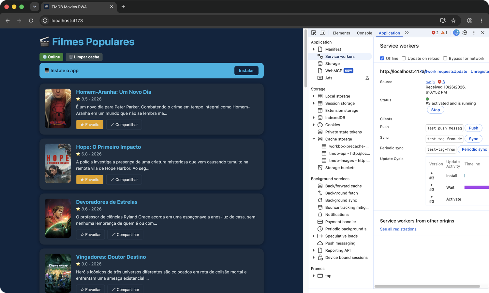
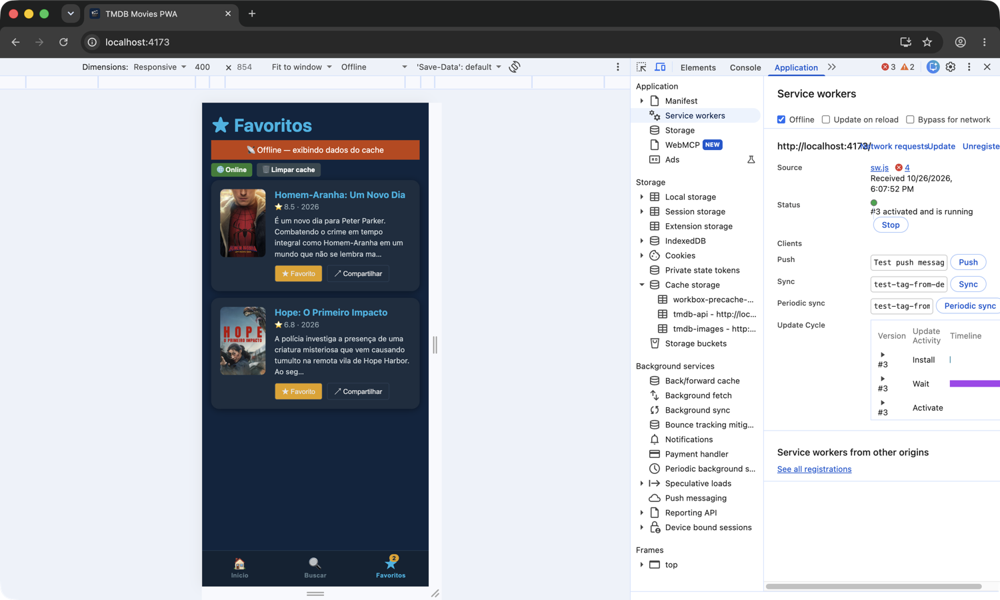
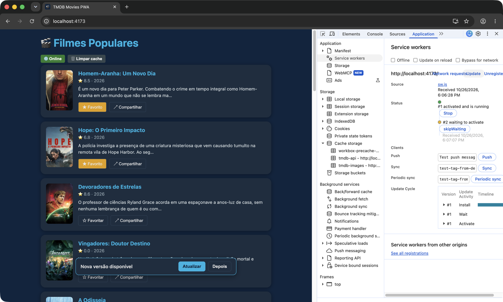

# ENTREGA — Atividade 4 (PWA)

**Nome:** Paulo Aranha · **GitHub:** aranha

---

## 1. Site comum × PWA — o que EU vi (3 diferenças)

Comparei `https://pwa-tmdb-aula4.vercel.app` com `https://www.themoviedb.org` no Chrome do meu Mac (prints da tela, com o DevTools aberto): offline → recarregar; fechar o navegador e reabrir já offline; DevTools → Application. O offline foi ligado pela caixa **Offline** do DevTools (marcada nos prints).

| # | Site comum (themoviedb.org) | PWA (pwa-tmdb-aula4) | Print/evidência |
|---|---|---|---|
| 1 | **Offline → recarregar:** página de erro do Chrome (dinossauro, `ERR_INTERNET_DISCONNECTED`). | Abre normalmente com os 20 filmes e os pôsteres: o Service Worker serve o *app shell* do Cache Storage e a lista sai do cache. | [site](evidencias/00-site-comum-offline-reload.png) · [PWA](evidencias/00-pwa-professor-offline-reload.png) |
| 2 | **Fechar o navegador e reabrir já offline:** erro de novo — nada ficou guardado para uso offline. | Reabre normalmente: o SW e os caches persistem entre sessões do navegador, não só na aba aberta. | [site](evidencias/00-site-comum-reaberto-offline.png) · [PWA](evidencias/00-pwa-professor-reaberto-offline.png) |
| 3 | **DevTools → Application → Service workers:** vazio (nenhum SW); Cache Storage e IndexedDB vazios. | `sw.js` com status **"#1 activated and is running"** controlando a página; Cache storage e IndexedDB com conteúdo (`workbox-precache`, `tmdb-api`, `tmdb-cache`). | [site](evidencias/00-site-comum-devtools.png) · [PWA](evidencias/00-pwa-professor-devtools.png) |

> **Sobre o botão verde "🌐 Online" nos prints (aqui e na seção 2):** é o simulador de rede do próprio app (`NetworkToggle`), não o estado real da conexão — ele não muda com o Offline do DevTools. O estado real é a caixa **Offline** marcada no DevTools.

**O que me surpreendeu (instalação):** o themoviedb.org **também** tem manifest com `display: standalone` e o Chrome mostra o botão **Install** na barra de endereço (veja o print `00-site-comum-devtools.png`) — desde o Chrome 108/112 instalar pelo menu não exige SW. Ou seja: "ter ícone na tela inicial" não é o que diferencia um PWA; o que faz ele funcionar offline é o **Service Worker**. Sobre ícones: quando testei pela 1ª vez (19/10), o PWA publicado dava o erro de instalabilidade `no-acceptable-icon` (o manifest apontava para ícones que não existiam); na versão atual ("versão v2", 26/10) os ícones foram publicados e ele ficou instalável. O scaffold da atividade tinha o mesmo problema (`icons/pwa-192.png` e `pwa-512.png` ausentes): gerei PNGs a partir do `favicon.svg` e o meu build ficou instalável — o Chrome mostra o **Install** e o banner "💻 Instale o app" já na 1ª visita (`05-app-pronto-offline.png`, feito ainda com os meus ícones). Depois o professor publicou os ícones oficiais no repositório (commit `6f4a183`), e a entrega usa os dele.

## 2. Prova do offline no SEU build

Build de produção (`npm run build && npm run preview`, http://localhost:4173).

- [x] Print do **DevTools → Application → Cache Storage** com `tmdb-api` e `tmdb-images` (com itens)
  - [`01-cache-storage.png`](evidencias/01-cache-storage.png): `tmdb-images` com **128 pôsteres**, todos `Response-Type: opaque` — por isso o `cacheableResponse: { statuses: [0, 200] }` é obrigatório.
  - [`01b-cache-storage-api.png`](evidencias/01b-cache-storage-api.png): `tmdb-api` com as páginas 1–7 de `/movie/popular`, `Response-Type: cors` (a API manda CORS, então o status 200 é legível).
- [x] Print do app **offline** carregando a lista
  - [`02-offline-lista.png`](evidencias/02-offline-lista.png): caixa **Offline** marcada no DevTools + recarregar → lista e pôsteres abrem do cache (conferi que as requisições à API falham).
  - [`03-favoritos-offline.png`](evidencias/03-favoritos-offline.png): modo celular do DevTools, aba ★ com 2 favoritos e badge **2**; com a aba aberta liguei o Offline e apareceu a faixa `📡 Offline — exibindo dados do cache` (TODO 5) — ela some ao voltar online.
- [x] Print do aviso **"Nova versão disponível"**
  - [`04-nova-versao.png`](evidencias/04-nova-versao.png): mudei um texto, rodei `npm run build` e cliquei em **Update** (DevTools → Service workers) → o SW novo ficou em **"#2 waiting to activate"**, o toast apareceu e a página **continuou na versão antiga**; em **Atualizar** recarregou com o texto novo.
  - [`05-app-pronto-offline.png`](evidencias/05-app-pronto-offline.png): toast "App pronto para uso offline" na 1ª visita, com o SW "#1 activated and is running".

  

**O que aprendi testando:**
- Na 1ª visita a página **não** é controlada pelo SW (`navigator.serviceWorker.controller` é `null`); só depois de recarregar 1× as regras de `runtimeCaching` passam a valer.
- Logo depois do reload o `tmdb-images` pode aparecer **vazio**: o Chrome serve as imagens já exibidas pela *memory cache*, que é consultada antes do SW. Rolando a lista (pôsteres novos) o cache enche.
- O offline foi pelo próprio DevTools (caixa **Offline**), não por modo avião físico.
- No Chrome 155, com o Offline do DevTools ligado, **depois de recarregar** a página o `navigator.onLine` volta a dizer `true` (as requisições continuam falhando). Por isso a faixa do TODO 5 aparece quando se liga o Offline com a aba ★ aberta (evento `offline`), e não depois de um reload.

## 3. Reflexão (5–8 linhas)

`autoUpdate` × `prompt`: qual você escolheria para um app de **checkout** e para um app de **notícias**, e por quê? O que pode dar errado em cada escolha?

**Checkout → `prompt`.** A tela tem estado sensível (carrinho, endereço, cartão digitado); com `autoUpdate` a versão nova assume sozinha e a página pode recarregar ou misturar JS antigo com cache novo no meio do pagamento — o usuário perde o que digitou ou, pior, a versão velha fala com uma API que já mudou. Com `prompt` ele termina a compra e atualiza quando quiser. O risco é clicar "Depois" para sempre e ficar numa versão velha: o backend precisa aceitar versões antigas por um tempo, ou o app oferece a atualização num momento seguro (ex.: após confirmar o pedido).

**Notícias → `autoUpdate`.** É conteúdo de leitura, sem formulário: aplicar a versão nova sozinho custa pouco e garante que todos recebem correções rápido. O que pode dar errado: o reload no meio de uma matéria perde a posição da leitura, e um bug publicado chega a todo mundo de uma vez (não existe "Depois") — exige rollback rápido.

## 4. Declaração de uso de IA

Sim. Usei o **Claude Code** (Anthropic, modelo Claude Opus 5.5) como assistente, com minha revisão em cada etapa:

- **Código:** implementação dos TODOs 1–5 a partir das especificações do enunciado e dos comentários. As decisões de escopo foram minhas: remover os comentários de instrução, mostrar os botões *Online / Limpar cache* também na aba Favoritos (como no slide 51), estilos do toast em `UpdatePrompt.styles.ts` e gerar os ícones `pwa-192/512` que faltavam (depois substituídos pelos oficiais que o professor publicou).
- **Verificação:** `npm test`, `npm run build`, o validator do professor (12/12) e roteiros Playwright no Chrome para conferir cache, offline, Favoritos e o fluxo de atualização.
- **Evidências:** os prints são capturas da tela do meu Mac (janela do Chrome com o DevTools aberto), com a navegação e os cliques feitos pelo Claude Code via protocolo de depuração do Chrome; o offline foi pela caixa Offline do DevTools, não modo avião físico.
- **Este ENTREGA.md:** rascunho da tabela, das notas e da reflexão feito com a IA e revisado por mim.
